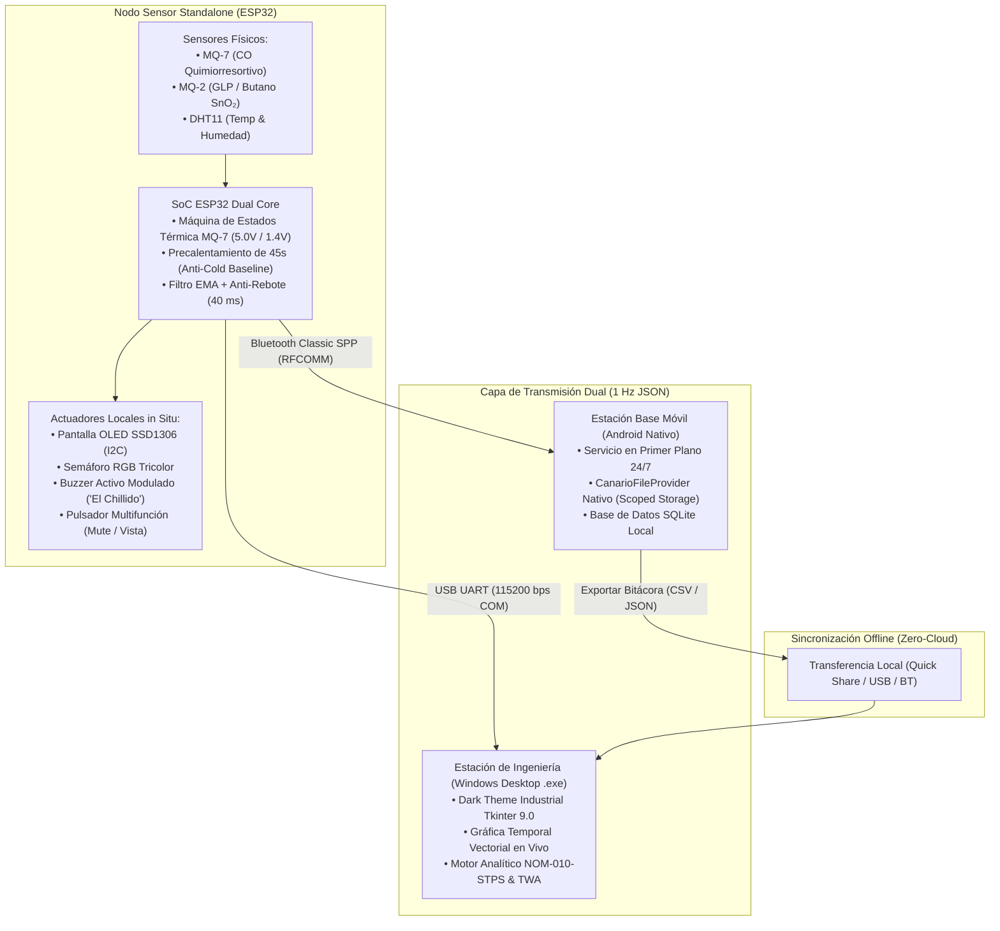

# El Canario Chillador 🐤⚠️
### Sistema IoT Standalone de Alerta Temprana, Supervisión Atmosférica & Higiene Industrial

[](https://github.com/SaxorRust/ProyectoCanarioChillador/actions/workflows/devsecops-audit.yml)
[](https://github.com/SaxorRust/ProyectoCanarioChillador)
[](docs/guias/fuentesNormasCalibracion.txt)
[](https://github.com/SaxorRust/ProyectoCanarioChillador)
[](LICENSE)

---

## 1. Resumen Ejecutivo y Filosofía de Diseño

Inspirado en la histórica metáfora del *canario en la mina de carbón*, **El Canario Chillador** es un sistema ciberfísico IoT de instrumentación ambiental y alerta temprana pasiva diseñado para detectar acumulaciones críticas de **Monóxido de Carbono (CO)** y **Gases Combustibles / Humo (GLP, Butano, Propano)** en entornos residenciales, comerciales e industriales.

### Principio Fundamental: Autonomía Total (Edge Computing / Zero-Cloud)
A diferencia de los detectores IoT convencionales que dependen de routers Wi-Fi domésticos, servidores en la nube o suscripciones SaaS, este sistema fue concebido bajo la premisa de **confiabilidad crítica ante emergencias**:
* **Operación Autónoma in Situ:** El nodo sensor toma decisiones de vida o muerte en milisegundos mediante actuadores locales (pantalla OLED de alto contraste, semáforo tricolor y buzzer acústico modulado), funcionando sin conexión a internet ni dependencia de un teléfono emparejado.
* **Emisión Dual Simultánea (Serial UART + Bluetooth Classic SPP):** Distribuye telemetría en tiempo real (1 Hz en formato JSON estandarizado) tanto a una estación base móvil (App Android nativa) como a una consola de escritorio de ingeniería (App Windows x64).
* **Persistencia Local y Auditoría Forense:** Almacenamiento descentralizado en SQLite en los clientes móvil y desktop, permitiendo sincronización cruzada sin infraestructura de red centralizada.

---

## 2. Diagrama de Arquitectura del Sistema



---

## 3. Fundamentación Científica y Normativa Oficial Mexicana

A diferencia de proyectos educativos con umbrales arbitrarios, los parámetros de alarma y el procesamiento de señales de este sistema están calibrados de acuerdo con la regulación mexicana e internacional:

| Parámetro | Límite Normado | Regulador Oficial | Acción del Canario |
| :--- | :--- | :--- | :--- |
| **CO (VLE-PPT)** | **$25.0\text{ ppm}$** | **NOM-010-STPS-2014** (Higiene Ocupacional 8h) | Alarma preventiva visual en semáforo (Ámbar) y cálculo de TWA. |
| **CO (Peligro)** | **$100.0\text{ ppm}$** | **CENAPRED / Protección Civil** (Riesgo Inmediato) | **Chillido acústico continuo bitono** y evacuación inmediata. |
| **GLP (VLE-CT)** | **$1000.0\text{ ppm}$** | **NOM-010-STPS-2014** (~5% del Límite Inferior de Explosividad) | Alarma acústica con bips pausados preventivos. |
| **GLP (Deflagración)**| **$3200.0\text{ ppm}$** | **NOM-002-STPS-2010 / NOM-033-STPS** (20% LEL) | **Alarma de peligro crítico por riesgo inminente de explosión**. |

### Física del Sensor MQ-7 y Solución al "Efecto Trampa" de la Línea Base:
1. **Ciclo Térmico Estricto:** El sensor de monóxido de carbono requiere conmutación periódica mediante modulación PWM en el transistor 2N2222A:
   - **Fase de Purga ($5.0\text{ V}$ continuo, 60 s):** Desorción térmica de impurezas y evaporación de humedad en la pastilla de $\text{SnO}_2$. Durante esta fase la resistencia cae temporalmente y se inhiben falsas alarmas.
   - **Fase de Medición ($1.4\text{ V}$ eficaz, 90 s):** Calefacción a modulación PWM de $7.84\%$ de ciclo de trabajo útil. Temperatura molecular ideal para quimiorresorción de CO.
2. **Rutina de Precalentamiento de 45 Segundos:** Al arrancar en frío, los sensores poseen voltajes basales muy bajos ($\sim 0.04\text{ V}$). Si la línea base se fijaba al encender, al calentarse a $300\ ^\circ\text{C}$ ($\sim 0.30\text{ V}$) el sistema interpretaba el aire limpio como gas acumulado. El firmware ahora ejecuta 45 segundos de preparación antes de capturar el reposo real en caliente.
3. **Validación Empírica:** Pruebas documentadas en [`tests/hardware_logs/`](tests/hardware_logs/) con humo de cerillos ($\text{SO}_2$), resinas de piretroides (raidolito) y gas butano.

---

## 4. Lista de Materiales (BOM) & Conexiones

| Componente | Función en el Sistema | Pin ESP32 (38 Pines) |
| :--- | :--- | :--- |
| **ESP32 NodeMCU-32S** | SoC Principal (Dual Core 240 MHz, ADC1, Bluetooth Classic) | Tarjeta Madre |
| **Sensor MQ-7** | Detección de Monóxido de Carbono (CO) | **GPIO 35** (ADC1_CH7) |
| **Sensor MQ-2** | Detección de GLP, Gas Combustible y Humo | **GPIO 34** (ADC1_CH6) |
| **Sensor DHT11 / DHT22** | Compensación higrotérmica $f(T, RH)$ de curvas | **GPIO 4** (One-Wire) |
| **Transistor 2N2222A (BJT)** | Driver conmutador PWM para calefactor de MQ-7 | **GPIO 25** (LEDC PWM) |
| **Diodo 1N4007** | Supresor de picos inductivos flyback en filamento | Antiparalelo a pines H-H |
| **Pantalla OLED 0.96" I2C** | HMI in situ (Lecturas PPM, bar-graphs, estado térmico) | **GPIO 21** (SDA) / **GPIO 22** (SCL) |
| **Buzzer Activo** | "El Chillido" (Alarma sonora bitono modulada) | **GPIO 27** |
| **LED RGB Tricolor** | Semáforo visual (Verde=Seguro, Ámbar=Precaución, Rojo=Peligro)| **Rojo: GPIO 23** / **Verde: GPIO 19** / **Azul: GPIO 18** |
| **Pulsador Táctil** | Filtro anti-rebote: MUTE temporal (60s) / Cambio de vista OLED | **GPIO 13** (INPUT_PULLUP) |

---

## 5. Ecosistema de Clientes Multiplataforma

### 📱 Aplicación Móvil (Android Nativo)
* **Arquitectura Limpia:** Compilada en Java 21 puro con Android SDK 34 (`aapt2`, `d8`) sin dependencias Gradle/AndroidX.
* **Persistencia 24/7:** Servicio en primer plano (`TelemetryService`) con notificación persistente que mantiene viva la conexión Bluetooth y almacena lecturas en SQLite aunque la app esté cerrada.
* **Proveedor de Contenidos Seguro:** [`CanarioFileProvider`](android_app/app/src/main/java/com/canario/iot/CanarioFileProvider.java) para compartir bitácoras por Quick Share sin violar *Scoped Storage*.
* **Exportación Directa:** Guarda automáticamente las bitácoras CSV y JSON en la carpeta pública `Descargas` (`MediaStore.Downloads`).

### 💻 Estación de Ingeniería (Windows Desktop)
* **Binario Autónomo (`.exe`):** Empaquetado portable de 14.9 MB en Python 3.14 con Tcl/Tk 9.0 embebido.
* **Gráfica Temporal en Vivo:** Motor Canvas vectorial interactivo con trazado en tiempo real, auto-escalado y líneas de corte normativo.
* **Módulo de Sincronización:** Importador universal de bitácoras de celular con deduplicación de marcas de tiempo en SQLite.

---

## 6. Pipeline DevSecOps & Aseguramiento de Calidad (CI/CD)

El proyecto cuenta con un flujo integral de integración continua y seguridad en GitHub Actions ([`.github/workflows/devsecops-audit.yml`](.github/workflows/devsecops-audit.yml)), 100% certificado en verde:

1. **🔑 Detección de Secretos (Gitleaks):** Escaneo de todo el historial de Git para evitar fuga de claves o tokens.
2. **⚡ Calidad de Código (Cppcheck & Wokwi Lint):** Análisis estático del firmware C++ con severidad de estilo y validación sintáctica de circuito.
3. **🔍 SAST & OWASP Top 10 (Semgrep & Flawfinder):** Escaneo de vulnerabilidades en código Java y C/C++ (mitigación de *Path Traversal* y consultas SQL seguras).
4. **📦 Auditoría de Dependencias (Aqua Trivy & OWASP Dependency-Check):** Análisis de vulnerabilidades y componentes de terceros.
5. **🔌 Compilación Automatizada Firmware (Arduino CLI):** Verificación de compilación cruzada para target `esp32:esp32:esp32`.
6. **📱 Compilación Automatizada Android (SDK Nativo):** Ensamblado automatizado de APK con Java 21, `aapt2` y firma digital `apksigner`.

El estado del pipeline se puede monitorear localmente en cualquier momento mediante PowerShell:
```powershell
.\monitor_pipeline.ps1 -Watch
```

---

## 7. Descargas y Puesta en Marcha Rápida

Los binarios precompilados y listos para ejecutar se encuentran disponibles en el repositorio:

* **APK para Teléfonos Android:** [`android_app/dist/CanarioChillador-v1.0.apk`](android_app/dist/CanarioChillador-v1.0.apk)
* **Ejecutable para Windows PC:** [`desktop_app/dist/CanarioChillador-Desktop.exe`](desktop_app/dist/CanarioChillador-Desktop.exe)

### Compilación Local:
```powershell
# Compilar APK de Android
powershell -ExecutionPolicy Bypass -File .\android_app\build_apk.ps1

# Compilar Ejecutable Desktop (.exe)
powershell -ExecutionPolicy Bypass -File .\desktop_app\build_exe.ps1
```

---

## 8. Licencia y Créditos

Este proyecto se distribuye bajo la licencia **MIT** de código abierto. Consulta el archivo [LICENSE](LICENSE) para más detalles.

Desarrollado como proyecto de ingeniería por [SaxorRust](https://github.com/SaxorRust).
Para reportar vulnerabilidades o sugerencias, consulta la [Política de Seguridad](SECURITY.md).
